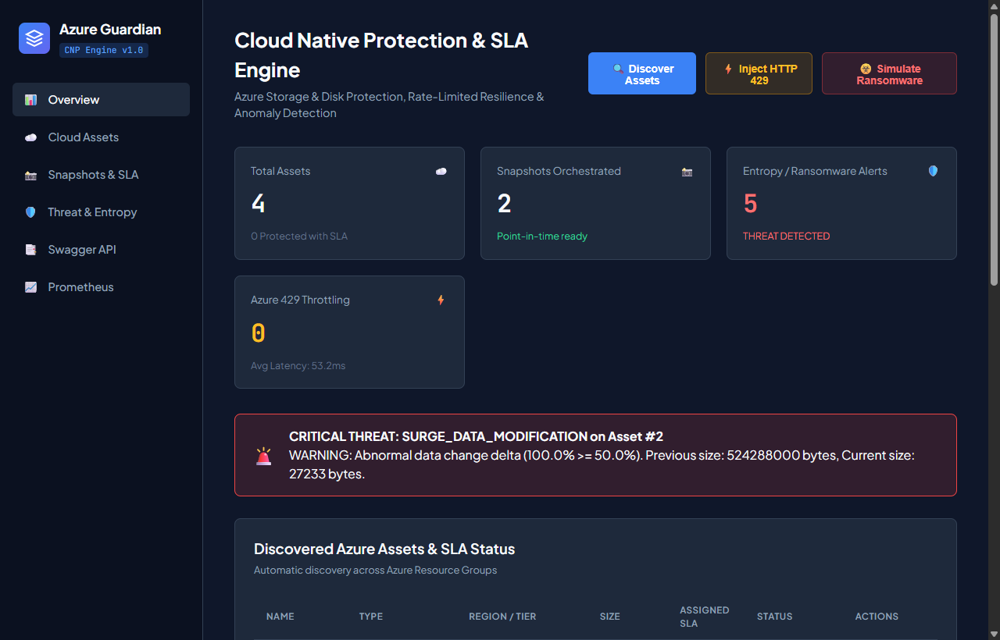
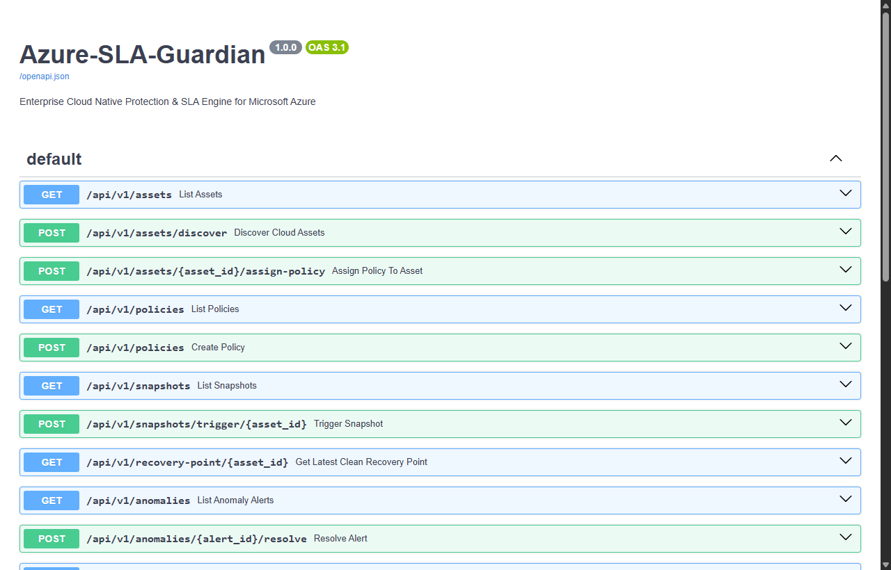
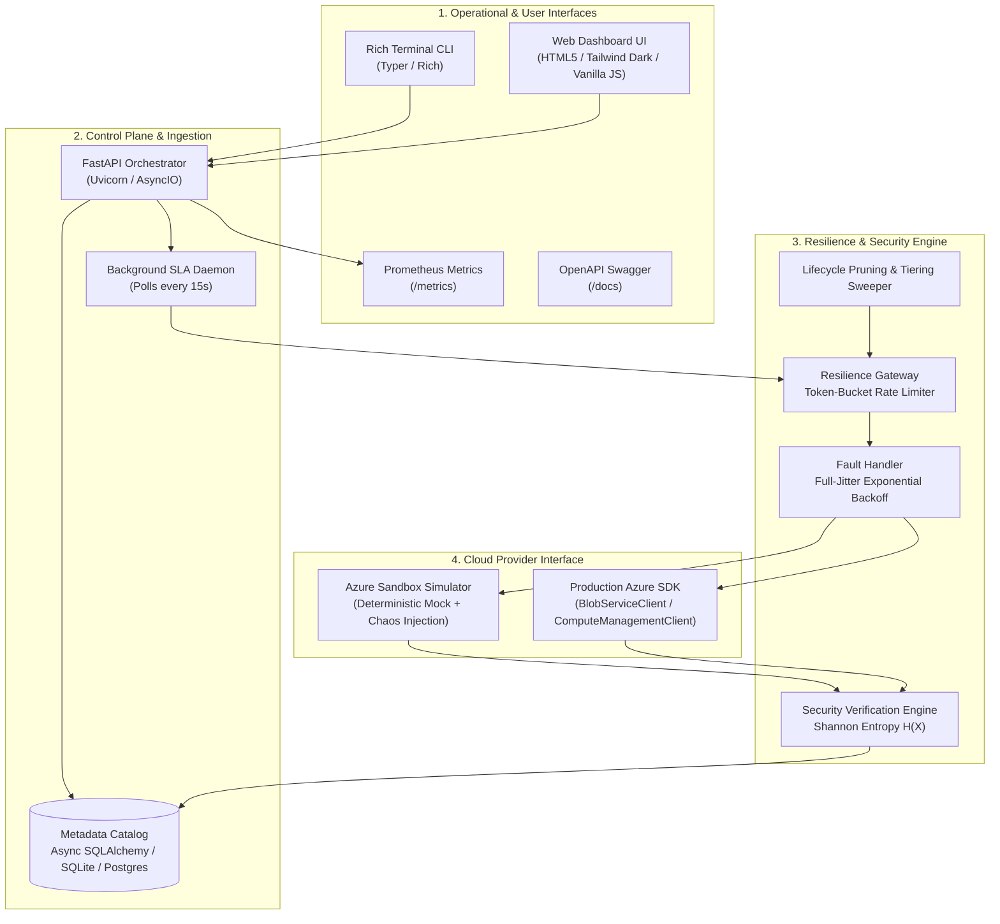
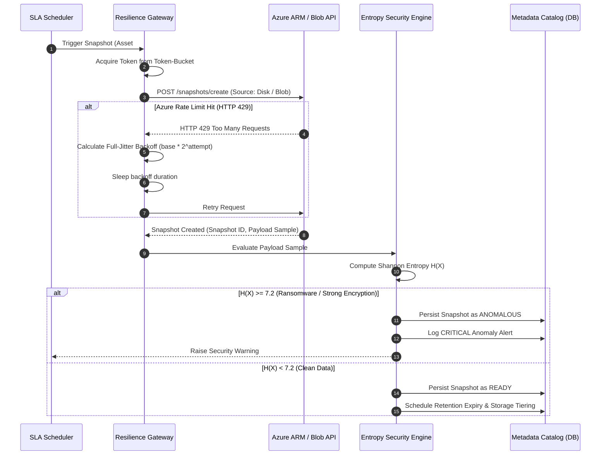
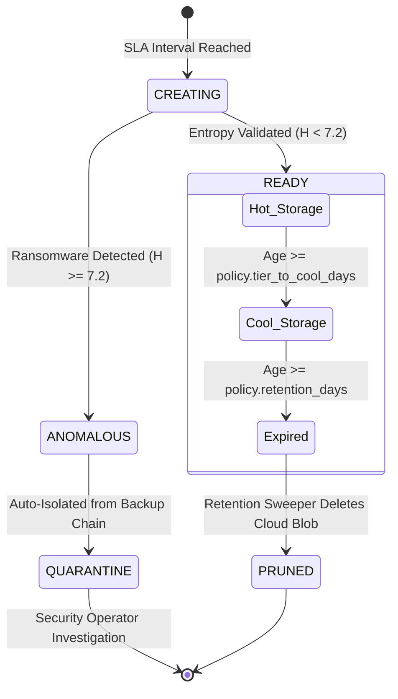

# Azure SLA Guardian: Cloud Native Protection & Policy Orchestration Engine

<div align="center">

[](https://www.python.org/)
[](https://fastapi.tiangolo.com)
[](https://www.docker.com/)
[]()
[](https://azure.microsoft.com/)
[]()

<br/>

**Enterprise-grade Cloud Native Data Protection (CNP) and disaster recovery orchestrator for Microsoft Azure.**  
Orchestrates SLA snapshot policies for Azure Storage & Compute, enforces token-bucket resilience against HTTP 429 throttling, detects ransomware through Shannon entropy analysis, and guarantees clean point-in-time recovery.

</div>

---

## 📸 Application Screenshots

### 1. Control Plane & SLA Management Dashboard
Real-time asset inventory, assigned SLA domains (Gold/Silver/Bronze), point-in-time snapshot catalog, and live rate-limiting telemetry:



---

### 2. Threat Detection & Ransomware Entropy Alert
Real-time security alert triggered when incoming backup data displays high Shannon entropy signatures ($H(X) \ge 7.2$), preventing corrupt or encrypted data from infecting the backup chain:


---

### 3. Interactive OpenAPI / Swagger Documentation
Full REST API control plane with self-documenting schema validation and interactive execution:



---

## 🏛️ System Architecture

Azure SLA Guardian is decoupled into four modular layers: an operational UI layer, an asynchronous API control plane, an internal resilience and threat detection engine, and a dual-mode cloud provider interface.



---

## 🔄 End-to-End Orchestration & Anomaly Detection Flow

When an SLA snapshot is triggered (either manually or via the background daemon), data passes through resilience and entropy validation before cataloging:



---

## 🔄 Snapshot Lifecycle & Tier Transition State Machine

Snapshots transition through storage classes to balance disaster recovery readiness with cloud storage expenditure:



---

## 🔬 Mathematical & Architectural Deep Dive

### 1. Token-Bucket Rate Limiter & Full-Jitter Backoff
Public cloud APIs (Azure Resource Manager) enforce aggressive quota throttling (`HTTP 429 Too Many Requests`). 
To handle massive parallel backups without exceeding cloud provider quotas:
* **Token-Bucket Smoothing**:
  $$\text{Tokens}(t) = \min(\text{Capacity}, \text{Tokens}(t_0) + (t - t_0) \times \text{Rate})$$
* **Full-Jitter Exponential Backoff**: When handling HTTP 429 or transient 503 errors, standard backoff causes synchronized client retries (the *thundering herd* problem). Full-jitter distributes the load uniformly across the time window:
  $$\text{Delay} = \text{random}(0, \min(T_{\max}, T_{\text{base}} \times 2^{\text{attempt}}))$$

### 2. Shannon Entropy Ransomware Detection
Ransomware encrypts customer files with strong symmetric ciphers (AES-256). Clean plaintext and database structures have structured byte distributions, whereas encrypted ciphertext produces an essentially uniform byte distribution.
The engine calculates Shannon Entropy across payload blocks:
$$H(X) = -\sum_{i=1}^{n} P(x_i) \log_2 P(x_i)$$
* **$H(X) \approx 0.0$**: Blank blocks or uniform byte streams.
* **$H(X) \approx 3.5 - 5.5$**: Natural text, source code, JSON, database tables.
* **$H(X) \ge 7.2$**: Strong symmetric encryption or compressed ransomware payloads (approaching the 8.0 theoretical limit).
* **Surge Delta**: Flags snapshots whose size changes by $>50\%$ between successive backups.

---

## ⚡ Quickstart Guide

### Option 1: Run with Docker Compose (Recommended)

```bash
# Clone the repository
git clone https://github.com/yourusername/azure-sla-guardian.git
cd azure-sla-guardian

# Start application via Docker Compose
docker compose up -d --build
```
Navigate to **`http://localhost:8000`** in your browser.

---

### Option 2: Run Locally with Python

```bash
# 1. Create and activate a Python 3.12 virtual environment
python -m venv .venv
.\.venv\Scripts\activate      # Windows PowerShell
# source .venv/bin/activate   # Linux / macOS

# 2. Install dependencies
pip install -r requirements.txt greenlet

# 3. Run automated test suite (13 tests)
pytest -v

# 4. Start the server
python -m guardian.cli serve --host 127.0.0.1 --port 8000
```

---

## 💻 Terminal CLI Commands

The CLI allows full administrative control directly from the shell:

```bash
# Discover cloud assets across Azure resource groups
python -m guardian.cli discover

# List all tracked assets and their SLA status
python -m guardian.cli list-assets

# Assign Gold SLA policy (ID: 1) to Asset #1
python -m guardian.cli assign-sla -a 1 -p 1

# Manually trigger a snapshot with entropy threat scan
python -m guardian.cli snapshot -a 1

# Chaos Engineering: Simulate a ransomware infection on customer-records
python -m guardian.cli simulate-ransomware --asset-name customer-records

# Retrigger snapshot to watch the entropy security alarm fire!
python -m guardian.cli snapshot -a 1
```

---

## 🌐 REST API Endpoints

| Method | Endpoint | Description |
| :--- | :--- | :--- |
| `GET` | `/` | Web Control Plane Dashboard |
| `POST` | `/api/v1/assets/discover` | Scans and catalogs cloud resources |
| `GET` | `/api/v1/assets` | Returns all discovered assets |
| `POST` | `/api/v1/assets/{id}/assign-policy` | Assigns Gold/Silver/Bronze SLA domain |
| `GET` | `/api/v1/snapshots` | Returns snapshots with Shannon entropy ratings |
| `POST` | `/api/v1/snapshots/trigger/{id}` | Triggers point-in-time snapshot with threat scan |
| `GET` | `/api/v1/recovery-point/{id}` | Finds latest verified clean non-anomalous snapshot |
| `GET` | `/api/v1/anomalies` | Lists security alerts (ransomware, surge anomalies) |
| `GET` | `/api/v1/metrics/summary` | Real-time performance metrics and SLA compliance |
| `POST` | `/api/v1/simulate/inject` | Injects HTTP 429 throttling or simulated ransomware |
| `GET` | `/metrics` | Prometheus exposition format metrics |
| `GET` | `/docs` | Interactive OpenAPI Swagger documentation |

---

## 🧪 Test Suite Coverage

The project includes an automated test suite verifying edge cases:

```
tests/test_api.py::test_api_root_and_metrics                     PASSED [ 7%]
tests/test_api.py::test_api_full_discovery_and_snapshot_lifecycle PASSED [15%]
tests/test_entropy.py::test_entropy_zero_on_empty                PASSED [23%]
tests/test_entropy.py::test_entropy_low_on_repetitive_data       PASSED [30%]
tests/test_entropy.py::test_entropy_normal_text                  PASSED [38%]
tests/test_entropy.py::test_entropy_high_on_random_ciphertext    PASSED [46%]
tests/test_entropy.py::test_evaluate_snapshot_detects_ransomware PASSED [53%]
tests/test_entropy.py::test_evaluate_snapshot_detects_size_surge PASSED [61%]
tests/test_orchestration.py::test_end_to_end_orchestration_flow  PASSED [69%]
tests/test_rate_limiter.py::test_token_bucket_allows_within_cap  PASSED [76%]
tests/test_rate_limiter.py::test_token_bucket_throttles_burst    PASSED [84%]
tests/test_rate_limiter.py::test_resilient_recovers_from_429     PASSED [92%]
tests/test_rate_limiter.py::test_resilient_exceeds_max_retries   PASSED [100%]

============================= 13 passed in 1.46s =============================
```

---

## 📄 License

Distributed under the **MIT License**. See `LICENSE` for more information.
